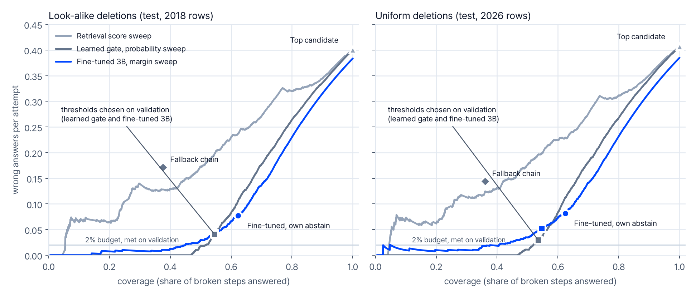

# selector-heal

A benchmark harness for repairing broken web locators. A recorded step (an
end-to-end test, a product guide, an RPA script) stores a locator for the
element it acted on. When the page changes, that locator can match nothing,
match several elements, or quietly match the wrong one. The question here is
narrow:

> Given the recorded element and the elements on the changed page, pick the one
> that does the same thing now, or say it is gone.

A wrong pick is the expensive mistake, so every method is scored on what it
repairs *and* on how often it is wrong when it answers. The benchmark is
synthetic: public pages are snapshotted, changed by a mutation engine weighted
by real locator changes from [ReproBreak](https://github.com/rub-sq/ReproBreak),
and only steps whose stored locator actually breaks become test rows.



*Held-out test split under both deletion conditions (55 sites never used for
training or thresholds). Each curve sweeps one method's threshold over the
test rows, so the curves describe this test set and were not used to choose
anything. Squares mark the learned gate's and the fine-tuned model's
thresholds chosen on validation for a 2% error budget. The same base model
without fine-tuning is off the chart at 57% wrong answers per attempt.*

## What the numbers say

On 2,018 broken steps from 55 held-out sites, look-alike deletions
([full tables](docs/RESULTS.md)):

| method | answered | successor recall | abstains on removed controls | wrong per attempt |
|---|---|---|---|---|
| Always take the top retrieved candidate | 100% | 0.892 | 0.000 | 0.400 |
| Fallback chain over the step's other recorded locators | 38% | 0.464 | 0.837 | 0.171 |
| Logistic gate on 12 retrieval features (p >= 0.572) | 55% | 0.778 | 0.938 | 0.041 |
| Qwen2.5-3B-Instruct, not fine-tuned | 61% | 0.392 | 0.550 | 0.571 |
| Same model, QLoRA fine-tuned, own abstain point | 62% | 0.856 | 0.934 | 0.077 |
| Same model, fine-tuned, margin >= 2.01 | 55% | 0.777 | 0.965 | 0.043 |

Successor recall is the share of steps whose control still exists that get the
right element. "Abstains on removed controls" is the share of steps whose
control was deleted on which the method declines to answer. Wrong per attempt
counts wrong picks and "repairs" of deleted controls over everything the
method answered.

- **Recall alone puts the always-answer baseline first.** The correct element
  is the top retrieved candidate for 89% of the steps whose control still
  exists, so always answering gets the highest recall and is still wrong on
  40% of its answers: it also answers every step whose control was removed.
- **Against the logistic gate, the fine-tuned model trades risk for recall.**
  At its own abstain point it answers more, recovers more (recall +0.046 to
  +0.109 over the gate, paired 95% interval over site groups) and is wrong
  more often (+0.015 to +0.061 wrong per attempt). At the margin threshold
  chosen on validation the two give nearly identical numbers: recall 0.777 vs
  0.778 and 4.3% vs 4.1% wrong, with every paired interval for recall, error
  rate and coverage including zero. That is not a demonstration of
  equivalence, and with uniform deletions the model was wrong on 5.2% of its
  answers against 3.0% for the gate (paired difference +0.009 to +0.036).
  This matched-threshold comparison was added after the test results.
- **The model does better when allowed to answer more.** In an exploratory
  sweep over the test rows, at 70% coverage it is wrong on 13.7% of answers
  with 0.90 recall, against 17.8% and 0.86 for the gate. At 50% coverage and
  below, the gate has the lower error rate.
- **Thresholds did not transfer.** Every threshold met the 2% budget on the
  14 look-alike validation sites it was chosen on. On the 55 test sites the
  same thresholds gave 3.0% to 6.4% wrong answers per attempt, 1.5 to 3.2
  times the budget.
- **Candidate order matters.** Scored with the same candidates in four
  different orders, the fine-tuned model (at its own abstain point) reaches a
  different outcome under at least one order for one row in eight (12.4%),
  while aggregate recall stays between 0.853 and 0.858.

Intervals, the uniform-deletion condition, per-strategy breakdowns and an
identifier survey of public admin consoles are in
[docs/RESULTS.md](docs/RESULTS.md).

## One row

```
jandi.com, test split. The generator rewrote the link's label.

recorded   <a> "로그인" (Log in)     href=/landing/kr/signin     box (1335, 15, 69, 36)
stored     getByRole('link', { name: '로그인', exact: true })
after      the link now reads "전체 보기" (View all). The stored locator still matches
           exactly one element -- another "로그인" link, in the footer. No error is raised.

top candidates by retrieval score
  10.29   <a> "로그인"     href=/landing/kr/company    box (1200, 6766, 36, 19)    wrong
   7.13   <a> "전체 보기"  href=/landing/kr/signin     box (1319, 15, 85, 36)      correct
   4.60   <a> "전체 보기"  href=https://blog.jandi.com/ko                          wrong

top candidate: the footer link (wrong)     learned gate: abstains (p = 0.26)
fallback chain: its CSS path finds the right link     fine-tuned 3B: picks it (margin +3.55)
```

## How it works

1. **Collect.** Headless Chromium renders each public URL, stamps every element
   with a tracking id and saves the DOM together with the stylesheets, fonts and
   images it loaded. Later renders are offline and repeatable.
2. **Record.** For each sampled control the recorder stores the first locator
   that uniquely finds it: test id, a hand-written-looking id, a form `name`,
   `getByRole` with the accessible name, `getByText`, then a CSS path. All
   resolution goes through Playwright.
3. **Change.** Each variant applies a bundle of edits (class churn, id and
   attribute changes, tag swaps, wrappers, reordering, relabelling) with
   bundle frequencies derived from ReproBreak, and removes 3-15% of the
   controls, either at random or preferring ones with a look-alike left behind.
4. **Keep only real breaks.** A step becomes a row only if its stored locator
   fails on the changed page. Every sampled step gets a ledger status, and the
   gates check the counts, the labels, the split and a byte-identical rebuild.
5. **Compare.** Rule baselines, a logistic gate, and Qwen2.5-3B-Instruct
   quantized to 4 bits with a LoRA adapter, which answers with one
   candidate-label token or `-` for "none of these". Thresholds are chosen on
   validation sites with a fixed rule before any test row is scored.

[docs/METHOD.md](docs/METHOD.md) has the details and the evaluation protocol,
which was committed before any test row was scored.
[docs/PITFALLS.md](docs/PITFALLS.md) lists the ways this kind of benchmark
silently produces wrong numbers, and what the code does about each.

## Running it

Python 3.10+.

```bash
pip install -e ".[dev,plot]"
python -m playwright install chromium
pytest -q
```

The tests run the whole pipeline offline on the six hand-made pages in
`fixtures/pages`: collect, build, gates (including a byte-identical rebuild),
splits, the learned gate and the report. No GPU or network needed. The same
steps by hand, ending with the baseline evaluation:

```bash
selector-heal collect --html-dir fixtures/pages --out work/fx/snapshots
selector-heal split --snapshots work/fx/snapshots --config configs/split_fixtures.json --out work/fx/splits.json
selector-heal build --snapshots work/fx/snapshots --out work/fx/lookalike --variants 6 --deletion lookalike
selector-heal build --snapshots work/fx/snapshots --out work/fx/uniform --variants 6 --deletion uniform
selector-heal check --data work/fx/lookalike --manifest work/fx/splits.json --rebuild work/fx/snapshots
selector-heal fit-gate --data work/fx/lookalike --manifest work/fx/splits.json --out work/fx/gate.json
selector-heal report --config configs/report_fixtures.json --root work/fx --out work/fx/report
```

`work/fx/report/tables.md` then holds the rule baselines and the learned gate
on the two fixture test pages. Six pages give about 80 broken steps per
deletion condition (about 40 of them on test pages), enough to check a healer
end to end but not to compare methods; `--variants` raises the count. The
fixture report config uses a 10% budget and a 3-attempt minimum instead of
2% and 30.

### Scoring another healer

Each line of `<build>/rows.jsonl` is one broken step. What a healer could
know at run time: `step` (the recorded element), `locator` and `primary` (the
stored locator and its strategy), `n_matches` (how many elements it matches
now), `fallback` (the step's other recorded locators and what they match now),
`candidates` (up to 40 elements of the changed page in retrieval order, each
with a `track` id) and `url`. Everything else (`gold_ids`, `successor`,
`lineage`, `retrieval`, `break`, `bundle`, `applied`, `target_axes`,
`deletion`) is a label or generator metadata.

To score a healer, write one JSON line per row of a split:

```json
{"row_id": "...", "row_fp": "...", "order": "shuffle:1", "forced": "c32", "gate_margin": 1.7, "pred": "c32"}
```

`forced` is the `track` it would pick if it had to answer, `gate_margin` how
willing it is to answer (higher is more), and `pred` its answer at its own
operating point, or `null` to abstain. `row_fp` is
`selector_heal.infer.row_fingerprint(row)`; the report refuses a file made
from different rows. `order` must equal the config's `order` (default
`shuffle:1`). Add the files to a report config as
`"model": {"val": "...", "test": "..."}` for each condition: the report then
scores the healer in the rows labelled "Fine-tuned", chooses its threshold on
validation and adds the paired comparisons with the top candidate and the
learned gate.

### The full run

The full run collects about 200 public URLs, builds four datasets, fine-tunes
the model (about 2.3 hours on one RTX 3090) and runs it over the test split
seven times (four candidate orders, the uniform condition, and the base model
on both conditions). The command sequence is at the end of
[docs/METHOD.md](docs/METHOD.md). Fine-tuning needs `pip install -e ".[train]"`
and a CUDA GPU with bf16 or fp16 support.

## Layout

```
src/selector_heal/   collect, render, locator (the recorder), mutate, retrieval,
                     build, gates, splits, prompts, train, infer, baselines,
                     metrics, report, survey, reprobreak, cli
configs/             split rules and report configurations (full run, fixtures)
data/urls/           the page lists (main, test, consoles)
data/distributions/  change frequencies derived from ReproBreak
data/splits.json     every collected page, its site group, split and hashes
data/survey/         the console identifier survey
results/             summary.json and tables.md from the published run
fixtures/pages/      hand-made pages for the offline tests
```

## Limitations

- Synthetic changes on public landing, documentation and portal pages. The
  screens people actually record guides on are mostly behind a login, and real
  releases change pages in ways this engine does not model.
- Removed controls are a third of the test rows (662 of 2,018), far more than
  the 3-15% deletion rate, because a removed control always breaks its step
  while most edits leave the stored locator working. Error rates depend on
  that mix.
- One fine-tuning run with one seed; training variance is not measured.
- One hand-written retriever. A different one changes both the difficulty and
  the baselines.
- Equivalence between controls is decided from static HTML by a stated policy
  (same destination for links; same label plus id or test id otherwise).
- The page snapshots are not published (they are other people's pages); the
  URL lists, the collector and the content hashes are. Sites change, so a
  re-collection gives a different corpus.

## License

The code is MIT (see `LICENSE`). `data/distributions/reprobreak_changes.json`
holds aggregate counts derived from ReproBreak, which is MIT-licensed by
Software Quality @ Ruhr University Bochum (see `NOTICE`). No model weights or
adapters are included; the training code uses Qwen2.5-3B-Instruct, which is
distributed under the Qwen Research License.
